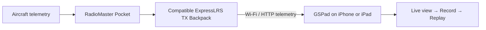

  

# GSPad: Give Every Flight a Story

**Live telemetry, flight recording, and replay on iPhone and iPad.**

[Download on the App Store](https://apps.apple.com/us/app/gspad/id6832260857) · [Support & setup](https://gspad-support.honedhumor2.chatgpt.site/) · [Privacy policy](https://gspad-support.honedhumor2.chatgpt.site/privacy)

## Telemetry files and firmware updates

The **RadioMaster Pocket ESP8285 TX Backpack** telemetry package is available here:

- **[Download Telemetry v3 firmware](https://raw.githubusercontent.com/khalidalketbi/GSPad/main/firmware/backpack-1.5.7/Pocket-Backpack-1.5.7-NavPad-Telemetry-v3.bin.gz)** — Backpack 1.5.7 with the GSPad-compatible HTTP endpoints.
- **[Download stock Backpack 1.5.7](https://raw.githubusercontent.com/khalidalketbi/GSPad/main/firmware/backpack-1.5.7/Pocket-Backpack-1.5.7-Stock.bin.gz)** — legacy upgrade and recovery file; stock firmware alone does not add the HTTP endpoints.
- **[Read the update instructions first](updates/README.md)** — target checks, installation, recovery, and current verification limits.
- **[Telemetry API](telemetry/README.md)** · **[Source, build instructions, and checksums](firmware/backpack-1.5.7/README.md)** · **[Change log](CHANGELOG.md)**.

The original firmware filenames use **NavPad Telemetry**, the earlier project name. This is the HTTP telemetry package used by GSPad. These files update the **Backpack**, which has separate firmware from the radio's RF transmitter. Firmware updates are managed outside the App Store app.

The aircraft is back on the ground. You remember the climb, the turn, and that stretch where it really picked up speed. Now comes the fun question: what did the flight actually look like?

Meet **GSPad**, a flight telemetry viewer and recorder by **Khalid Alketbi**. It brings the aircraft's position and available flight data to your iPhone or iPad, lets you record the session, and helps you explore it afterward. Think of it as a flight notebook with a map and a replay button.

## A small screen with a bigger picture

With a compatible **RadioMaster Pocket and ExpressLRS TX Backpack**, GSPad turns incoming telemetry into a live view of your flight.

| What you can follow | What it helps you see |
| --- | --- |
| Aircraft position and route | Where the aircraft is and the path it has taken |
| Speed and altitude | How the flight changes through climbs, turns, and faster sections |
| GPS information | Whether valid aircraft position data is arriving |
| Available battery and link readings | The power and connection information your setup reports |

The readings depend on the telemetry supplied by your aircraft and hardware. A field can only tell its story when the aircraft sends the data.

## How the pieces fit together

The Backpack provides the local Wi-Fi connection that GSPad uses to read telemetry. Your aircraft's GPS supplies its position.

**Before you begin:** live telemetry needs a Backpack running firmware that already provides **GSPad-compatible HTTP telemetry**. A stock or otherwise unsupported Backpack setup may not provide that endpoint. The App Store app uses the existing firmware; check **Set Up Pocket** and the [support guide](https://gspad-support.honedhumor2.chatgpt.site/) for compatibility.

GSPad is a telemetry viewer and recorder. Aircraft control stays with your radio and flight system.

## Your first session, step by step

### 1. Get the app

Install [GSPad from the App Store](https://apps.apple.com/us/app/gspad/id6832260857) on an iPhone or iPad running **iOS 17 / iPadOS 17 or later**. The app supports **English and Arabic**.

### 2. Prepare the Pocket

On a compatible Pocket setup, open **ExpressLRS → Backpack**, set **Telemetry → WiFi**, and use **Normal** link mode. You can revisit the instructions in GSPad through **Set Up Pocket**.

### 3. Join the Backpack's network

On your iPhone or iPad, open **Settings → Wi-Fi** and join the **ExpressLRS TX Backpack** network. If the device asks, choose **Without Internet** to stay connected to that local network.

### 4. Connect and find your aircraft

Return to GSPad, allow **Local Network** access, and tap **Connect**.

When valid aircraft GPS data arrives, the aircraft marker can appear on the map. Connected but no marker yet? Check that the aircraft is actually reporting a valid GPS position.

### 5. Capture the flight

Tap **Record flight** to begin, then **Stop recording** when you are finished.

You now have something better than “I think that was the fast bit”: a saved flight you can revisit.

### 6. Press replay

Open **Flight History**, choose a recording, and tap **Play** or move through the timeline. Follow the route again and inspect the telemetry along the way.

## The flight ends. The exploring continues.

Replay gives those numbers a little context. You can inspect the route in **2D or 3D**, review telemetry charts, and use the **Flight Report** to explore the statistics available from the recorded samples.

Want to share the route's story? The replay tools also include **MP4 video export**.

A recording reflects the data GSPad received. Gaps in telemetry can limit the detail in the route, charts, and report.

## Heading somewhere with patchy internet?

Prepare before you leave. Use **Offline Maps** to download terrain for the area while you still have an internet connection.

That downloaded terrain supports offline 3D viewing. Online map imagery and terrain you have not downloaded can still need internet access, so terrain preparation is worth doing before you join the Backpack network.

## Three quick fixes

- **No live readings?** Check that you joined the Backpack Wi-Fi, allowed Local Network access, and have compatible HTTP telemetry firmware.
- **A connection, but no aircraft on the map?** Check for valid GPS data from the aircraft.
- **Terrain missing later?** Download the relevant area in Offline Maps while online, before heading out.

## Ready to give your next flight a replay button?

Start with the app, check your hardware compatibility, and make your first recording.

- **[Download GSPad](https://apps.apple.com/us/app/gspad/id6832260857)**
- **[Read the setup and support guide](https://gspad-support.honedhumor2.chatgpt.site/)**
- **[Read the privacy policy](https://gspad-support.honedhumor2.chatgpt.site/privacy)**

If you find GSPad useful, share this guide with another pilot or star this repository to help others discover it.

---

Created by **Khalid Alketbi**. This repository contains GSPad's public introduction, usage guide, and Pocket Backpack telemetry package. The firmware directory includes its GPLv3 license and corresponding source.

*App Store availability and device requirements checked on November 21, 2026. For current availability, see the App Store listing.*
